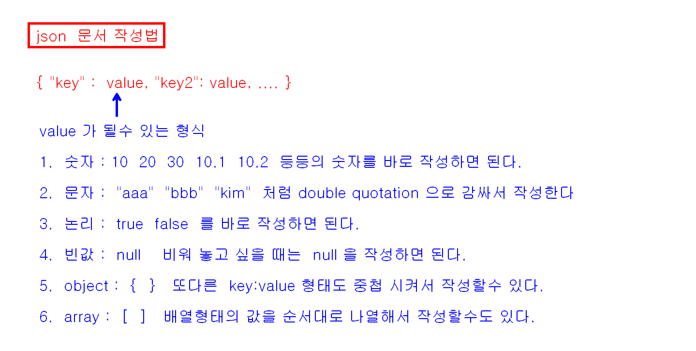
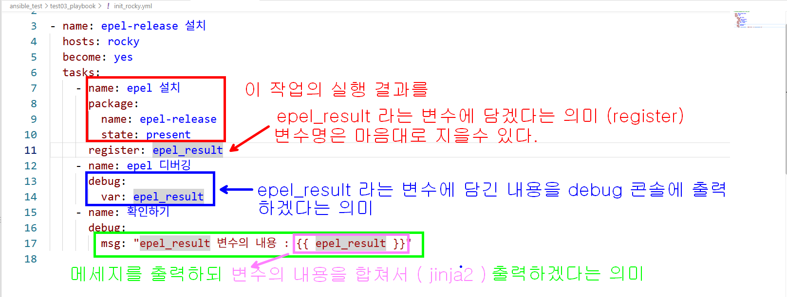
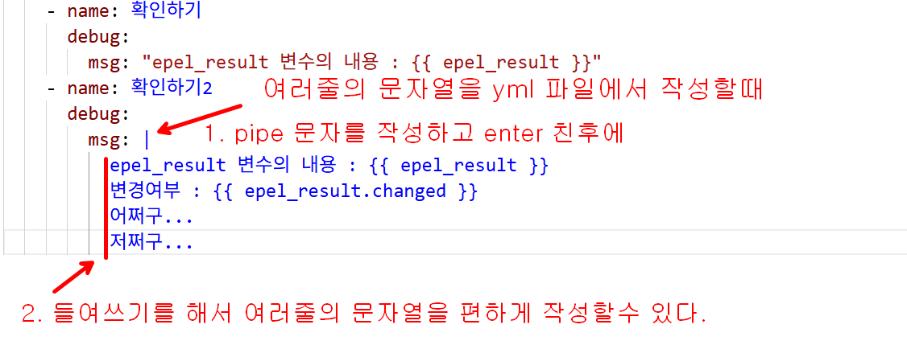
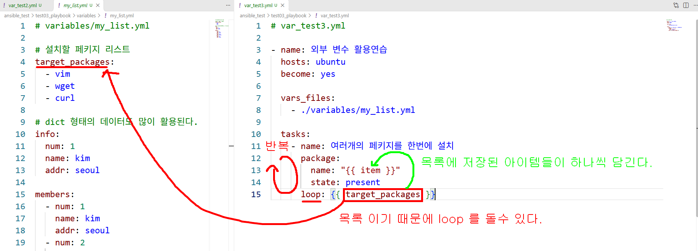

# json 문서 작성법 정리



# yml 문서와 json 문서의 차이


# ansible playbook 실행방법


## yml 파일의 의미



## yml 파일에서 여러줄의 문자열 작성



## yml 과 json 비교 1

```yml
target_packages:
  - vim
  - wget
  - curl
```

```json
{
  "target_packages": ["vim", "wget", "curl"]
}
```

## yml 과 json 비교 2

```yml
info:
  num: 1
  name: kim
  addr: seoul
```

```json
{
  "info": {
    "num": 1,
    "name": "kim",
    "addr": "seoul"
  }
}
```
## yml 과 json 비교 3

```yml
members:
  - num: 1
    name: kim
    addr: seoul
  - num: 2
    name: park
    addr: inchon
  - num: 3
    name: lee
    addr: pusan
```

```json
{
  "members": [
    {
      "num": 1,
      "name": "kim",
      "addr": "seoul"
    },
    {
      "num": 2,
      "name": "park",
      "addr": "inchon"
    },
    {
      "num": 3,
      "name": "lee",
      "addr": "pusan"
    }
  ]
}
```

## loop 테스트

