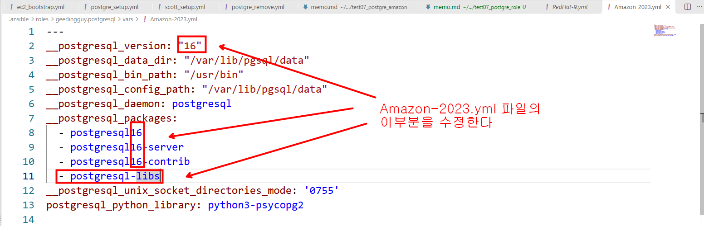

## role 설치

```bash
# geerlingguy.postgresql  role 설치
ansible-galaxy install geerlingguy.postgresql

# aws 의 amazon linux 는 아래의 설정을 추가 해야 한다 

# ~/.ansible/roles/geerlingguy.postgresql/vars/RedHat-9.yml 파일을 복사해서 Amazon-2023.yml 로 둔갑시킨다 

아래는 수정할 내용 Amazon-2023.yml 의 내용
---
__postgresql_version: "16"
__postgresql_data_dir: "/var/lib/pgsql/data"
__postgresql_bin_path: "/usr/bin"
__postgresql_config_path: "/var/lib/pgsql/data"
__postgresql_daemon: postgresql
__postgresql_packages:
  - postgresql16
  - postgresql16-server
  - postgresql16-contrib
  - postgresql-libs
```

