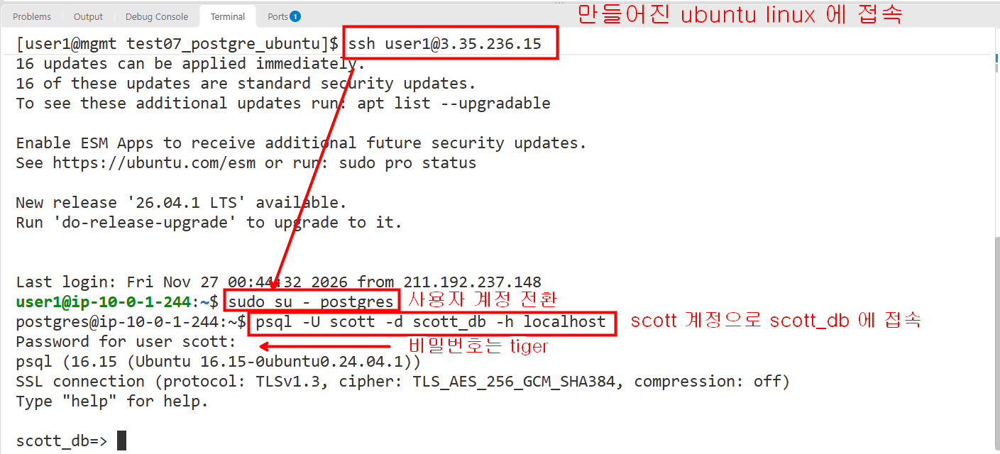

```bash

# user1 계정으로 접속 가능하게 하기
ansible-playbook  ec2_bootstrap.yml

# postgresql 설치
ansible-playbook postgre_setup.yml

```

## 만들어진 ubuntu linux 에 접속해서 scott 계정확인하기



```bash
# ssh 접속
ssh user1@ubunut의아이피주소

# 사용자 전환
sudo su - postgres

# scott 계정으로 scott_db 에 접속 
psql -U scott -d scott_db -h localhost

```