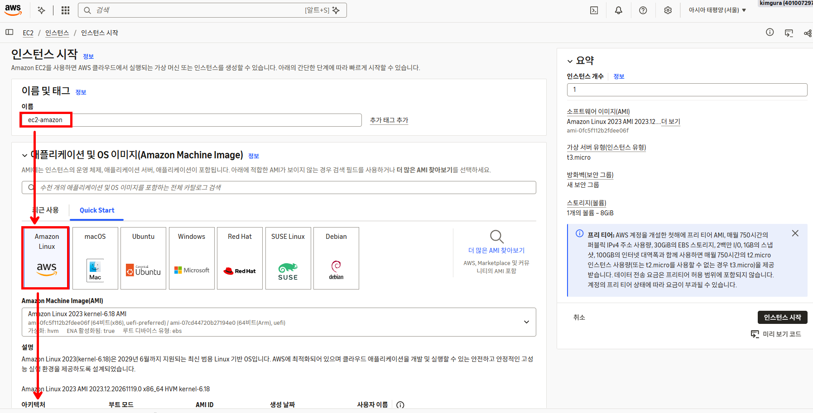
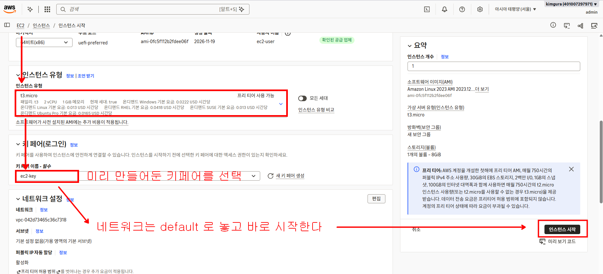
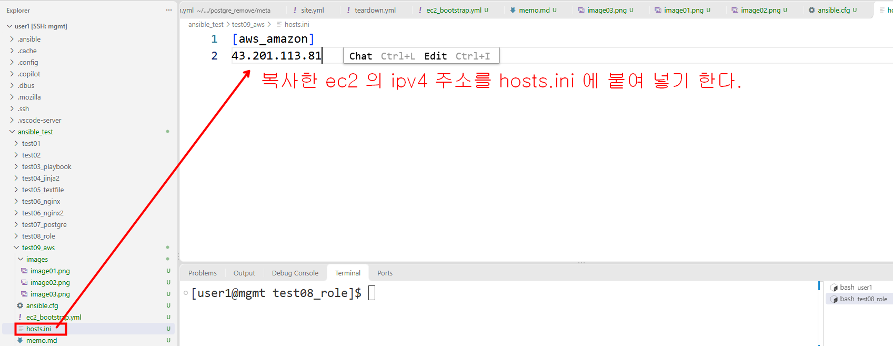
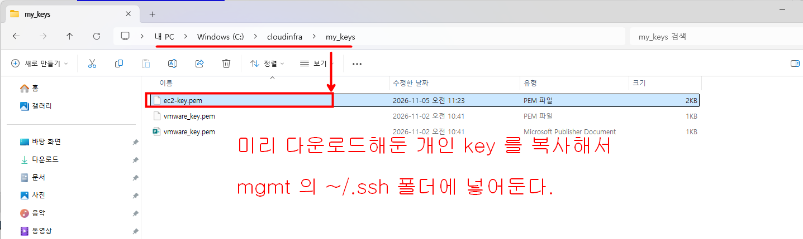
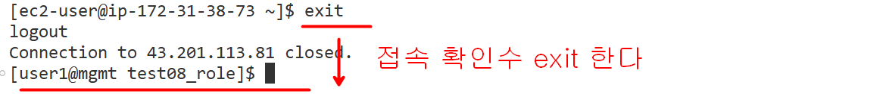
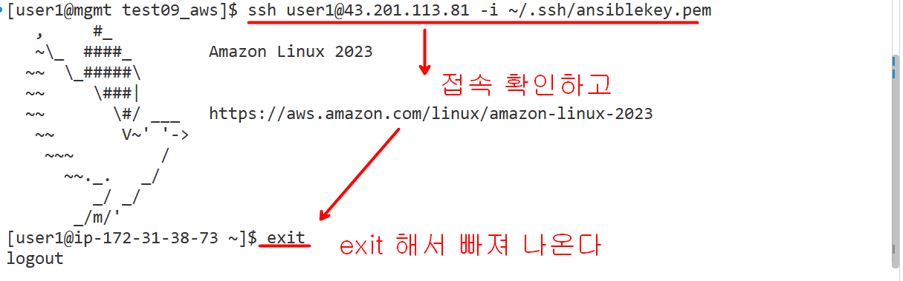

## amazon linux ec2 만들기








## 테스트로 ec2 에 접속해 보기

```bash
chmod 600 ~/.ssh/ec2-key.pem
ssh ec2-user@43.201.113.81 -i ~/.ssh/ec2-key.pem
```





## ec2_bootstrap.yml 을 실행해서 user1 을 만들고 접속 가능한지 확인

```bash
ansible-playbook ec2_bootstrap.yml
ssh user1@43.201.113.81 -i ~/.ssh/ansiblekey.pem
```



