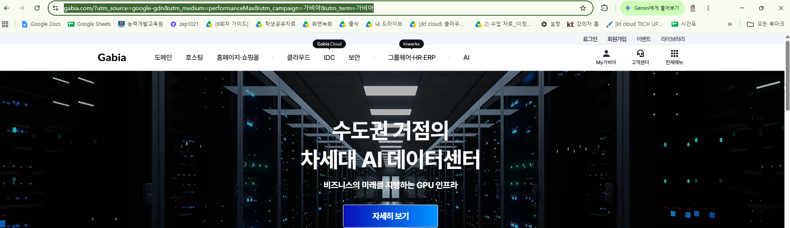
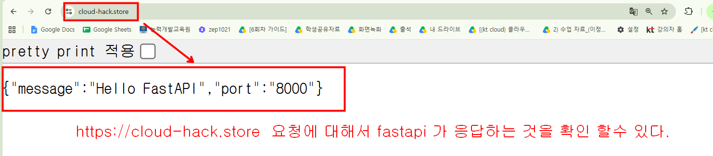

## 실습을 위해 gabia 에서 domain 을 하나 구매한다

<a href="https://www.gabia.com/">가비아</a>


### 가입 및 로그인 해서 구매하기 



### ansible galaxy role 을 설치한다 (geerlingguy.nginx , geerlingguy.certbot)

```bash
# role 설치
ansible-galaxy install geerlingguy.nginx
ansible-galaxy install geerlingguy.certbot
```

### ansible galaxy site

<a href="https://galaxy.ansible.com/ui/">ansible galaxy</a>

### 아래와 같은 순서대로 실행한다

```bash
# ec2 에 user1 으로 접속해서 playbook 을 실행할수 있도록 준비한다.
ansible-playbook ec2_bootstrap.yml

# nginx 설치
ansible-playbook nginx_setup.yml

# certbot 를 이용해서 인증서 발급
ansible-playbook certbot_setup.yml

# https 환경에서 nginx 가 동작하도록 설정 
ansible-playbook nginx_https.yml

# fastapi WAS 실행
ansible-playbook fastapi_setup.yml
```

### 웹브라우저로 요청해 보기

